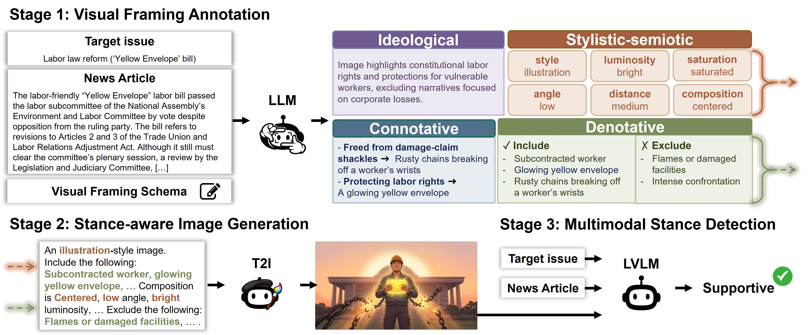

# VFStance

Official implementation of **Visual Framing for News Stance Detection via Image Generation** (EMNLP 2026) [[paper](https://aclanthology.org/2026.emnlp-main.2524/)] [[arXiv](https://arxiv.org/abs/2609.00685)].

VFStance leverages visual framing to make implicit stance cues in news articles explicit through image generation. It consists of three stages:

1. **Visual Framing Annotation**: an LLM annotates a visual framing specification for the article.
2. **Stance-aware Image Generation**: a text-to-image model generates an image from the specification.
3. **Stance Detection**: an LVLM predicts the article's stance from the article and the generated image.

<p align="center">
  
</p>

## Installation

Install the dependencies with pip:

```bash
pip install -r requirements.txt
```

Alternatively, create the provided Conda environment:

```bash
conda env create -f environment.yml
conda activate vfstance
```

For API-based models, create `.env` in the repository root:

```text
GOOGLE_API_KEY=...
OPENAI_API_KEY=...
```

## Dataset

K-News-Stance-MM is not included in this repository. Follow [`data/README.md`](data/README.md) to request the dataset, then place it at:

```text
data/k-news-stance-mm.json
```

Each record follows this structure:

```json
{
  "id": 42,
  "issue": "'개 식용 금지법' 국회 본회의 통과",
  "genre": "analysis",
  "news_outlet": "...",
  "link": "...",
  "publish_date": "...",
  "headline": "...",
  "images": [
    { "url": "...", "caption": "..." }
  ],
  "article": "...",
  "article_stance": "neutral",
  "split": "test"
}
```

`article_stance` is one of `supportive`, `neutral`, or `oppositional`. VFStance does not use the original news images; only their source URLs are provided in `images[].url`.

The dataset is licensed under [CC BY-NC 4.0](https://creativecommons.org/licenses/by-nc/4.0/).

## Running VFStance

Run all commands from the repository root. Each stage reads the outputs of the previous stage and writes its own outputs under `outputs/`.

```bash
# Stage 1: article -> visual framing annotation
bash scripts/stage1_visual_framing_annotation.sh --backend api

# Stage 2: annotation -> generated image
bash scripts/stage2_stance_aware_image_generation.sh --backend api

# Stage 3: article + generated image -> stance
bash scripts/stage3_stance_detection.sh --backend api
```

To run all stages at once:

```bash
bash scripts/run_all.sh --config full --backend api
```

Use `--limit N` to run on the first N articles, and `--help` on any script to view its paths and model settings.

### VFStance (Text)

VFStance (Text) skips image generation and provides the Stage 1 annotation to the stance predictor as text:

```bash
bash scripts/run_all.sh --config text --backend api
```

### Open-Weight Models

The fully open configuration in the appendix uses InternVL3-14B-Instruct for Stages 1 and 3 and Stable Diffusion 3.5 Large for Stage 2. Install the additional dependencies, log in to Hugging Face to access gated models, and run with `--backend open`:

```bash
pip install -r requirements-open.txt
huggingface-cli login
bash scripts/run_all.sh --config full --backend open
```

## Additional Materials

- [`docs/prompts_translated.md`](docs/prompts_translated.md): English translations of prompts not translated in the paper
- [`docs/case_studies.md`](docs/case_studies.md): case studies not included in the paper

## License

The code and dataset are shared under [CC BY-NC 4.0](https://creativecommons.org/licenses/by-nc/4.0/).

## Citation

```bibtex
@inproceedings{lee-etal-2026-visual,
    title = "Visual Framing for News Stance Detection via Image Generation",
    author = "Lee, Dahyun  and
      Han, Jiyoung  and
      Park, Kunwoo",
    editor = "Lee, Hung-Yi  and
      Dev, Sunipa  and
      Li, Junyi Jessy  and
      Elliott, Desmond",
    booktitle = "Proceedings of the 2026 Conference on Empirical Methods in Natural Language Processing",
    month = oct,
    year = "2026",
    address = "Budapest, Hungary",
    publisher = "Association for Computational Linguistics",
    url = "https://aclanthology.org/2026.emnlp-main.2524/",
    doi = "10.18653/2026.emnlp-main.2524",
    pages = "57393--57418",
    ISBN = "979-8-89176-459-0",
    abstract = "Article-level news stance detection aims to identify the perspective of news articles toward social issues. Despite advances in stance detection and its importance for trustworthy media environments, news articles pose distinct challenges because their stances are often implicit, subtly conveyed through journalistic framing, and embedded in long, structurally complex texts. To address these challenges, we introduce VFStance, which leverages visual framing to make implicit stance cues more explicit via image generation. In evaluation experiments, we demonstrate the effectiveness of VFStance over existing methods and the contribution of visual framing to its performance. Finally, a controlled user study (N=200) in a snippet-based news consumption setting further demonstrates that VFStance can make stance signals visually salient and highlights its potential use beyond automated stance detection."
}
```
